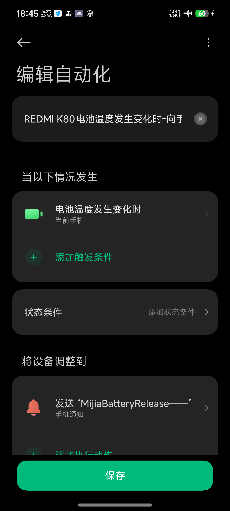
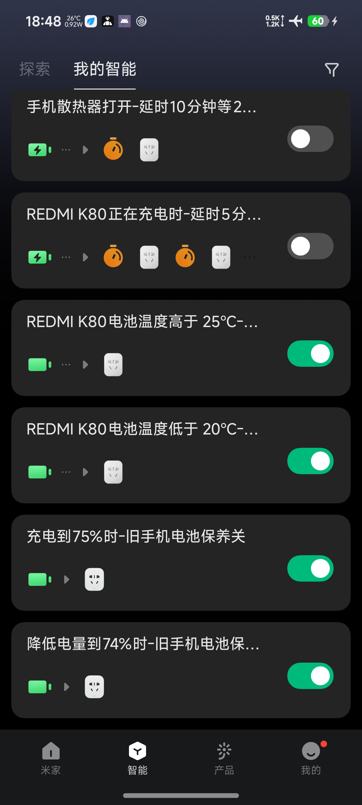

# 米家本机电池温度扩展

在米家 **个人设备 → 本机 → 当个人设备发生变化时** 的条件列表增加“电池温度变化”。KernelSU 模块负责充电期间采样，配套 LSPosed APK 负责新增菜单和接入手机自动任务识别。

**这是针对指定设备和应用版本的实验项目，不是小米官方功能。** 已在下述指定环境验证温度来源、条件保存和通知测试规则自动执行；专门的熄屏及长期后台测试尚未完成。不要把本项目用作唯一过热保护。

## 实机验证结果（2026-11-19）

本次验证使用 [v0.2.1-preview 发布版](https://github.com/Pb-ctrl/mijia-battery-temperature/releases/tag/v0.2.1-preview)，设备为 REDMI K80 / `zorn`，系统为 `OS4.0.3.0.XOKCNXM`（Android 17），米家 `11.1.845`，手机管家 `13.8.1-261023.0.1`。以下为该环境的一次实测记录，不代表其他机型或版本的兼容性。

| 验证项目 | 结果 |
| --- | --- |
| 发布版安装与重启 | KSU 模块和配套 APK 均为 `0.2.1-preview`（versionCode 3），重启后模块正常运行 |
| 安装文件一致性 | 手机已安装 APK 的 SHA-256 与 GitHub 发布资产一致；手机上的 `module.prop`、`source.sh`、`service.sh` 与发布 ZIP 一致 |
| 签名冲突处理 | 备份后卸载旧扩展 APK，再安装发布 APK、重新启用扩展并恢复作用域；保留米家数据 |
| LSPosed 配置 | 扩展已启用，作用域为米家与手机管家 |
| 条件保存 | 新增“电池温度发生变化时 → 发送手机通知”，保存后重新打开，条件和动作仍正确显示 |
| 自动触发 | 未点击手动执行；米家日志出现 18:41 一条、18:42 两条“执行成功” |
| 原有规则恢复 | 高于 25℃开散热器、低于 20℃关散热器均恢复开启；系统任务记录的 `enable` 均为 `1` |

测试结束后已删除临时通知规则。原有两条散热器规则的阈值和状态条件保留：高于 25℃且散热器关着时开启，低于 20℃且散热器开着时关闭。

### 温度来源核验

最后一次核验时，来源状态为 `kernel_battery_unmasked`，温度伪装模块 `temp_charge_boost` 不存在：

| 读取位置 | 原始数值 | 换算温度 |
| --- | --- | --- |
| `/sys/devices/virtual/thermal/thermal_zone75/temp` | `26000`（毫摄氏度） | 26.0℃ |
| `/sys/class/power_supply/battery/temp` | `260`（0.1℃） | 26.0℃ |
| 模块发布值 | `260`（0.1℃） | 26.0℃ |

来源检查通过、采样心跳正常。测试未写入模拟温度，也未修改驱动温控设置。这里的温度是手机传感器报告值，未使用外置温度计做独立校准。

### 验证截图与日志

<details>
<summary>查看规则保存后的页面</summary>



</details>

<details>
<summary>查看原有散热器规则恢复截图</summary>



</details>

自动触发结果见 [当时米家日志页面的文本提取记录](docs/verification/2026-11-19-trigger-log.txt)。此前本地标为“自动触发成功”的 PNG 实际是规则编辑页，因此此处按“规则保存后的页面”展示，不将它作为执行日志截图。

**验证范围：** 本次确认了条件保存及“温度发生变化”规则的自动执行；未单独确认通知栏弹出，未刻意升降温验证 25℃／20℃阈值跨越，也未完成专门的熄屏、长时间后台和网络中断恢复测试。首次有效读数也会触发，三条成功记录不能全部归因于后续温度变化。当前版本仅在充电或检测到外部供电时持续采样。

## 下载与安装

在 [Releases](https://github.com/Pb-ctrl/mijia-battery-temperature/releases) 下载同一版本的两份文件：

| 文件 | 用途 |
| --- | --- |
| `MijiaBatteryTemperature-KSU-*.zip` | 在 KernelSU 模块页安装 |
| `MijiaBatteryTemperature-*.apk` | 普通 APK 安装，在 LSPosed 中启用 |
| `SHA256SUMS.txt` | 安装包完整性校验 |

1. 确保当前系统已有正常工作的 LSPosed／兼容框架及其所需的 Zygisk 环境，不要叠装多套框架。
2. 安装 ZIP 和 APK，在 LSPosed 启用“米家电池温度扩展（实验版）”。
3. 作用域只勾选 **米家 `com.xiaomi.smarthome`** 和 **手机管家／安全服务 `com.miui.securitycenter`**，不需要系统框架。
4. 重启，连接充电器，打开配套 APK 检查采样来源及状态。
5. 进入米家本机条件列表，选择“电池温度变化”，再设置你需要的动作。

本项目不自动安装框架、修改作用域或重启手机。“采样在线”不证明框架已成功注入，也不证明米家场景已执行。

## 适配范围

| 项目 | 当前限制 |
| --- | --- |
| 设备 | REDMI K80 / `zorn` |
| 系统增量版本 | `OS4.0.3.0.XOKCNXM` |
| 米家 | `11.1.845`，版本代码 `11011845` |
| 手机管家／安全服务 | `13.8.1-261023.0.1`，版本代码 `40001381` |
| Root | KernelSU，需正常的模块支持 |

版本检查失败时会停止采样或不再注入。固定 thermal zone、私有接口和混淆方法名均需随系统／应用变化重新适配。

## 触发行为

- **仅充电时提供有效温度**：充电时约5秒采样，不充电时停止提供有效状态并约30秒检查一次。
- 支持任意温度变化、高于指定温度、低于指定温度；阈值为1～80℃整数，严格使用大于／小于比较。
- **首次有效读数满足条件会触发一次，包括“任意变化”。** 服务恢复、重新充电、应用进程重启后也可能再次产生首次触发。
- 后续高低温只在相邻采样从不满足进入满足时触发；任意变化在相邻有效采样不同的时候触发。没有额外温度回差，阈值附近波动可能多次跨越。
- 系统调度可能导致延迟，不能保证捕获两次采样之间的短暂变化。

## 温度来源与局限

无已识别伪装模块时，检查 `thermal_zone75` 为 `battery`，核查节点及标准电池接口为原始 sysfs、无文件或父目录覆盖，再比较两个读数。差异不超过1℃才发布 thermal 节点温度。不会回退到 `dumpsys`、电池广播、充电器温度或伪装模块快照。

源码保留手机当前脚本中的特定兼容分支：检测到 `temp_charge_boost` 版本代码149，且配置解析到 `aoss-0` 模拟接口时，直接读取未被覆盖的标准电池驱动接口，跳过 thermal 节点交叉检查。**这个分支基于指定版本与配置的启发式判断，不是对伪装模块二进制或传感器真实性的认证。** 未知驱动注入或其他伪装方式不在其证明范围内。

两条电池接口可能共享同一个底层驱动。“未被文件覆盖”“读数接近”均不等于独立硬件测温校准。本项目不改写温度节点、不关闭 SELinux、不调整充电参数。

## 限制与停用

温度条件采用独立实例标记，但借用现有手机电量属性的传输通道。**同一条规则不能同时使用“电量使用”和“电池温度变化”，也不支持多个温度条件。** 其他规则里的普通电量条件保留。扩展停止后，本地特殊编码不会匹配正常电量百分比。

在 KernelSU 停用模块后采样脚本退出；心跳超过45秒也会停止识别。重新启用后需重启采样服务。完全卸载前先移除相关米家温度规则，再关闭 LSPosed 扩展并卸载。

## 编译

主机需要 **Python 3.10+、JDK 17、Android SDK Platform 35、Build Tools 35.0.0**。无需 Gradle 或第三方 Python 包。

```shell
python scripts/build.py
```

产物在 `dist/`，包含 APK、KSU ZIP、SHA-256 文件。参见 [完整编译与签名方法](docs/BUILD.md)、[结构与验证范围](docs/ARCHITECTURE.md)、[版本记录](CHANGELOG.md)。

仓库不包含米家或手机管家的原始 APK、手机账号、其他 Root 模块、发布私钥或 GitHub 凭据。GitHub Actions 使用临时开发签名，不能与 Release 签名混用为覆盖更新。

## 许可与依赖

本项目采用 [MIT License](https://www.google.com/search?q=LICENSE) 开源协议。Xposed API 82 仅为编译依赖，下载自官方仓库并校验，不打包进 APK；框架和工具的许可由各自项目规定。

【免责声明】

本项目为个人开发的第三方实验性扩展，与小米、米家及相关设备厂商无隶属或合作关系，也未获得其官方认证。

模块涉及 Root、KernelSU 和 LSPosed，目前仅在帖子列出的设备、系统及应用版本上进行过验证，不保证其他环境下能够正常运行。系统或应用升级后，可能出现功能失效、条件识别异常、自动化误触发或漏触发等情况。

模块读取的是手机传感器报告的电池温度，读数可能存在误差和延迟；温度来源检查也无法保证识别所有形式的温度修改。因此，请勿将本项目作为电池安全保护、充电保护或过热保护的唯一依据，也不要依赖它执行无人看管的高风险操作。

安装前请备份相关数据，并确认有办法停用或卸载模块。建议先通过通知类动作验证，再用于控制实际设备。出现温度异常、自动化异常或系统不稳定时，请立即停用扩展，必要时停止充电并检查设备。

请在了解上述限制后自行决定是否使用，并遵守适用法律及相关服务规则。本声明不排除或限制依法不能免除的责任。

